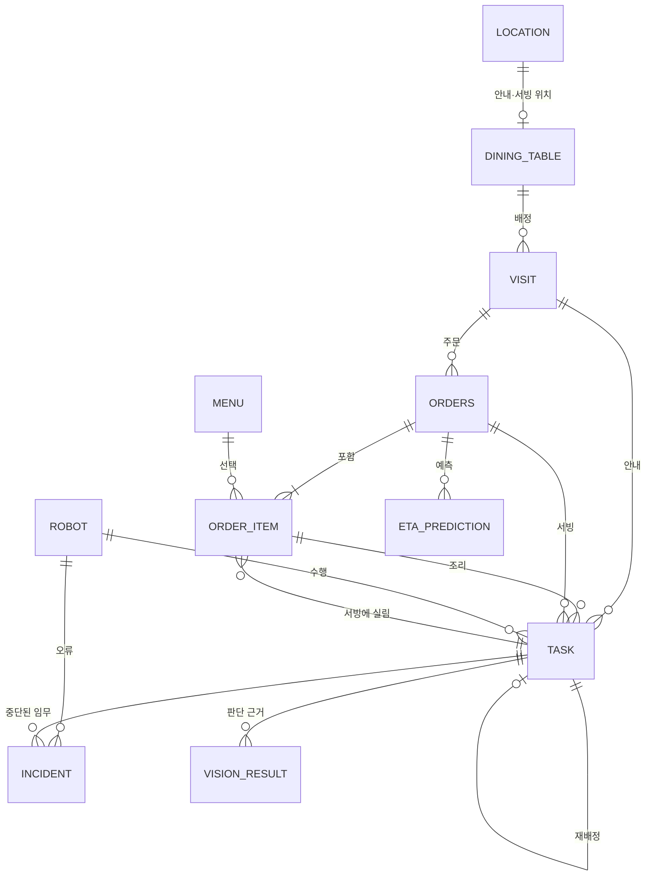

# FryBot 개념 데이터 모델 (v0.3 초안)

- 작성: 2026-11-10 / 상태: **팀 검토 전 초안** (11/13 상세설계 때 State Diagram과 함께 확정)
- 근거: Confluence `System Requirements` v6 (SR-001~038), `State Diagram` v3 (7장, 원본 `~/addinedu/design/frybot_state_diagram.drawio`), `System Architecture`
- 다음 단계: 이 문서 → [논리 모델](02_논리모델.md) → `db/init/01_schema.sql`

## 1. 목적과 범위
State Diagram의 흐름(입장 → 배정·안내 → 주문 → 조리 → 픽업·적재·서빙 → 이용 종료·정리, 오류·복구)을 운영하려면 **무엇을 기록해야 하는지** 정한다. 테이블과 컬럼 타입은 다루지 않는다.

**데이터 흐름 원칙**
- DB는 서버 PC 한 곳(MySQL)에만 둔다. **로봇에는 DB를 두지 않고, 로봇이 DB에 직접 접속하지도 않는다.**
- 상태는 State Diagram의 레인(주체)이 바꾼다. 손님, 테이블, 주문은 **서버/고객·테이블·주문 관리**가, 임무, 로봇, 오류는 **서버/Service Workflow**가 바꾼다.
- 로봇과 AI Server는 보고만 한다. 보고는 Workflow를 거쳐 DB에 저장된다.

**범위 밖:** 결제, 회원, 재고, 통행 순서 결정(SR-035, 실시간 처리라 DB에 저장하지 않음)

## 2. 엔터티
| 엔터티 | 설명 | 근거 | 상태 주체 |
|---|---|---|---|
| **위치** | 로봇이 가는 지점. 입구, 테이블 안내·서빙 위치, 픽업(받는 곳), 대기 지점, 충전대, 로봇팔 스테이션 | SR-002, SR-020, 5장 | (사전 등록) |
| **테이블** | 식탁. 식별자, 수용 인원, 위치, 이용 상태 | SR-002~004, SR-028~031 | 주문 관리 |
| **손님 그룹(방문)** | 입구 접수부터 이용 종료까지 한 팀 | SR-001, 2장 | 주문 관리 |
| **메뉴** | 치킨, 볶음밥. 조리 방식(튀김/웍)이 다르다 | SR-009, SR-016, SR-017 | (사전 등록) |
| **주문** | 테이블에서 확정한 주문 1건. 고유 주문 ID | SR-010~013 | 주문 관리 |
| **주문 항목** | 주문 안의 메뉴 1종과 수량. 항목별 서빙 준비 상태 | SR-014, SR-015 | Workflow |
| **로봇** | AMR, 로봇팔. 위치, 배터리, 운용 상태, 충전 여부 | SR-033, SR-037 | Workflow |
| **임무** | 로봇 1대가 하는 일 1건: 안내, 조리, 서빙 | SR-005, SR-014, SR-018~019, SR-034 | Workflow |
| **오류·복구 기록** | 장치 오류 또는 관리자 중단 1건과 처리 결과 | SR-036, SR-034, 7장 | Workflow |
| **AI 판단 결과** | 익힘 판정, 손님 거리 판단 | 2장, 4장 | Workflow (AI Server 결과 저장) |
| **ETA 예측** | 주문의 예상 완료 시간 (Colab 학습 모델) | 팀 결정(Colab 학습 2건) | Workflow |
| **기준값** | State Diagram의 "N" 값 (자동 수령 시간, 배터리 기준 등) | State Diagram 확인 사항 4 | 관리자 |
| **이벤트 이력** | 상태 변화, 알림, 관리자 조작 기록 | SR-038 | 모든 서버 구성요소 |

## 3. 관계
- 테이블 1개는 안내·서빙 위치 1개를 가진다.
- 손님 그룹은 테이블 0~1개를 배정받는다(대기 중에는 없음). **테이블 1개에 진행 중인 손님 그룹은 최대 1개다** (SR-004, SR-031).
- 손님 그룹은 주문을 0~N건 한다. 주문 1건은 주문 항목 1~N개를 가진다. 주문 항목은 메뉴 1개를 가리킨다.
- 임무 유형별 대상:
  - **안내** → 손님 그룹 1개
  - **조리** → 주문 항목 1개 (메뉴별 조리 작업, SR-014)
  - **서빙** → 주문 1건 + 그 서빙에 실린 주문 항목 1~N개 (SR-015, SR-018)
- 임무는 로봇 0~1대가 맡는다(가용 로봇이 없으면 대기, SR-005, SR-019). **로봇 1대에 진행 중인 임무는 최대 1건이다.**
- 관리자가 AMR 임무를 중단하면 같은 일을 하는 새 임무가 다른 AMR에 생긴다. 새 임무는 이전 임무를 가리킨다(재배정, SR-034).
- 오류·복구 기록은 로봇 1대, 임무 0~1건, 주문 0~1건과 연결된다(SR-036).
- AI 판단 결과는 임무 1건(조리, 안내)에 연결된다.
- ETA 예측은 주문 1건에 0~N건 생긴다.

## 4. 개념 ERD

## 5. State Diagram 장별 대응
| 장 | 흐름 | 생기거나 바뀌는 엔터티 |
|---|---|---|
| 2. 입장·배정·안내 | CHECK_IN → 대기/배정 → 안내 임무 → 동행 → 착석 | 손님 그룹, 테이블 상태, 안내 임무, AI 판단(손님 거리), 안내 예외 → 오류 기록 |
| 3. 주문 | 메뉴 선택 → 확정 → 주문 ID → 진행 상태 | 주문, 주문 항목, ETA 예측 |
| 4. 조리 | 메뉴별 조리 → 익힘 판정 → 인계대 | 조리 임무, AI 판단(익힘), 주문 항목 준비 상태 |
| 5. 픽업·서빙·복귀 | 서빙 임무 → 픽업 → 적재 → 테이블 → 수령 → 복귀·충전 | 서빙 임무, 주문 상태, 로봇 상태·충전 |
| 6. 이용 종료·정리 | 이용 종료 → 정리 대기 → 관리자 정리 완료 → 이용 가능 | 손님 그룹 종료, 테이블 상태 |
| 7. 오류·복구 | E_STOP → 보류 → 복구 대기 → 재시도 또는 중단(재배정/주문 취소) | 오류·복구 기록, 임무·주문 보류, 재배정 임무 |

## 6. 팀 확인이 필요한 것 (State Diagram 확인 사항과 연동)
| # | 질문 | 이 모델의 처리 | 결정되면 |
|---|---|---|---|
| Q1 | **로봇팔 대수**: SA 3대 vs 배치도 2대(치킨·웍) | 로봇 수와 무관한 구조. 시드 데이터는 배치도 기준 2대 | 시드에서 로봇만 추가/삭제 |
| Q2 | **인계대 → AMR 적재 주체**: SR-021은 로봇팔 | 서빙 임무의 단계(`LOADING`)로만 기록, 주체 컬럼 없음 | 적재를 별도 임무로 나누면 임무 유형 `LOAD` 추가 |
| Q3 | **SR-026 테이블 전달**(로봇팔) vs State Diagram 손님 수령 확인 | 손님 수령 확인 또는 N초 후 자동 수령을 주문에 기록 | 로봇팔 전달이면 임무 유형 추가 |
| Q4 | **손님 대기 등록**: SR에 없음 (SA·맵에는 있음) | 손님 그룹 `WAITING` 상태와 대기 번호 유지 | SR에 추가하거나, 범위 밖이면 상태를 삭제 |
| Q5 | **기준값 N** | 기준값 엔터티에 NULL로 등록 | 값만 입력 |
