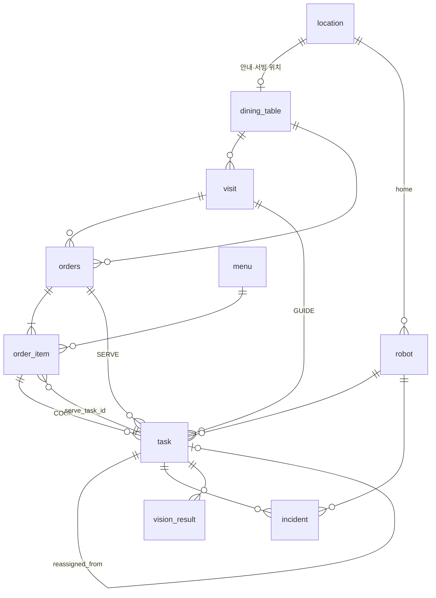

# FryBot 논리 데이터 모델 (v0.3 초안)

- 작성: 2026-11-10 / 상태: **팀 검토 전 초안**
- 근거: [개념 모델](01_개념모델.md), SR v6, State Diagram v3 (레인별 상태는 draw.io 원본에서 추출)
- 물리 반영: `db/init/01_schema.sql` (MySQL 8.4), `schema_version` = 3

## 0. 작성 원칙
1. **상태값은 State Diagram의 이름을 그대로 쓴다.** 상태를 바꾸는 주체는 그 상태가 놓인 레인이다.
2. State Diagram이나 SR에 근거가 없고 **DB 쪽에서만 필요한 것**은 SQL에서 **주석 처리**해 둔다. 이 문서에는 `🔶 DB 제안`으로 표시한다. 팀이 State Diagram이나 SR에 반영하기로 하면 주석을 해제한다.
3. DB는 서버 한 곳에만 둔다. 로봇은 DB에 접속하지 않고, ROS2로 Service Workflow에 보고한다.

## 1. 상태 정의 (State Diagram 기준)

### 1.1 레인별 상태 (원본 추출)
| 레인 (주체) | 상태 | DB 저장 위치 |
|---|---|---|
| 입구 접수 UI | CHECK_IN | `visit.status` 초기값 |
| 테이블 주문 UI | SELECTING, END_OF_USE(입력) | SELECTING은 **화면 상태라 저장하지 않음** |
| 서버/고객·테이블·주문 관리 | WAITING, ASSIGNED, IN_USE, END_OF_USE, CLEANING, AVAILABLE | `visit.status`, `dining_table.status` |
| 〃 (3장 주문) | ORDERED, COOKING, READY, SERVING, ARRIVED, COMPLETED, ON_HOLD, CANCELED | `orders.status` |
| 서버/Service Workflow | GUIDE_REQ, GUIDE_PENDING, GUIDE_EXCEPTION, COOK_TASK, SERVE_REQ, SERVE_PENDING, RECOVERY_WAIT, CHECK, RESUME, CANCEL_TASK, REASSIGN, CANCELED (+ 7장 ON_HOLD: 주문·임무 보류) | `task.state` |
| AI Server | FOLLOW_CHECK, DONENESS | `vision_result.kind` |
| AMR × 3 | IDLE, TO_ENTRANCE, GUIDING, PAUSED, ARRIVED, RETURNING, CHARGING, TO_PICKUP, QUEUED, DOCKED, SERVING, E_STOP | `robot.state` |
| 로봇팔 Station | IDLE, PICK_CHICKEN, FRYING, WAIT_TIMER, LIFT_AND_DRAIN, PICK_INGREDIENTS, STIR_FRYING, PLATING, ON_HANDOFF, RETRY, LOADING, E_STOP | `robot.state` |

### 1.2 테이블 `dining_table.status` — 주체: 고객·테이블·주문 관리
| 현재 → 다음 | 조건 | 근거 |
|---|---|---|
| AVAILABLE → ASSIGNED | 손님 그룹에 배정 (중복 배정 불가) | 2장, SR-003·004 |
| ASSIGNED → IN_USE | 안내 AMR 테이블 도착(착석) | 2장 |
| IN_USE → CLEANING | 이용 종료 확정 (미전달 주문 없음) | 6장, SR-028 |
| CLEANING → AVAILABLE | 관리자 정리 완료 입력 | 6장, SR-029 |
| (관리자 변경) | 관리자가 상태 변경 가능, 중복 배정은 불가 | SR-031 |

### 1.3 손님 그룹 `visit.status` — 주체: 입구 접수 UI → 고객·테이블·주문 관리
| 현재 → 다음 | 조건 | 근거 |
|---|---|---|
| (생성) CHECK_IN | 입구에서 인원 입력 | 2장, SR-001 |
| CHECK_IN → WAITING | 빈 테이블 없음 (만석) | 2장 |
| CHECK_IN/WAITING → ASSIGNED | 빈 테이블 있음 → 배정, 안내 임무 생성 | 2장 |
| ASSIGNED → IN_USE | 테이블 도착(착석) | 2장 |
| IN_USE → END_OF_USE | 이용 종료 확정 | 6장, SR-027 |
| 🔶 DB 제안 `CANCELED` | 대기 중 이탈, 안내 예외 후 포기 | State Diagram에 없음 → **주석** |

### 1.4 주문 `orders.status` — 주체: 고객·테이블·주문 관리 (Workflow 보고 반영)
| 현재 → 다음 | 조건 | 근거 |
|---|---|---|
| (확정) ORDERED | 주문 확정·유효 → 주문 ID 발급 | 3장, SR-011·012 |
| ORDERED → COOKING | 조리 시작 보고 | 3장 |
| COOKING → READY | 조리 완료 보고 (픽업 대기) | 3장 |
| READY → SERVING | 적재 완료 보고 | 3장, SR-022 |
| SERVING → ARRIVED | 테이블 도착 보고 | 3장, SR-024·025 |
| ARRIVED → COMPLETED | 손님 수령 확인 또는 N초 후 자동 수령 | 3장, 5장 |
| 진행 중 → ON_HOLD | 장비 오류 | 3장, 7장 |
| ON_HOLD → (멈춘 단계) | 관리자 재시도 → `hold_from_status`로 복귀 | 3장 |
| ON_HOLD → CANCELED | 관리자 취소, 조리 임무 중단 | 3장, 7장 |

### 1.5 임무 `task.state` — 주체: Service Workflow
| 상태 | 의미 | 근거 |
|---|---|---|
| GUIDE_REQ / COOK_TASK / SERVE_REQ | 임무 생성·전달. 로봇이 배정되면 진행은 `robot.state`로 본다 | 2·4·5장 |
| GUIDE_PENDING / SERVE_PENDING | 가용 AMR 없음, 대기 | SR-005, SR-019 |
| GUIDE_EXCEPTION | 손님을 N초 이상 놓침 → 관리자 알림 | SR-008 |
| ON_HOLD | 오류로 보류 (`hold_from_state` 기록) | 7장 |
| RECOVERY_WAIT → CHECK | 복구 대기 → 관리자 재시도 → 복구 조건 확인 | 7장, SR-036 |
| RESUME | 조건 OK → 멈춘 단계부터 재개 | 7장 |
| CANCEL_TASK | 관리자 중단 → 정지 확인 | 7장, SR-034 |
| REASSIGN | AMR 임무 → 가용 AMR에 새 임무로 재배정 (새 임무가 `reassigned_from_task_id`로 가리킴) | 7장, SR-034 |
| CANCELED | 조리 임무 중단 → 주문 취소 | 7장 |
| 🔶 DB 제안 `DONE` | 임무 완료. State Diagram에는 완료 상태가 없음 → **주석**. 대신 `finished_at`에 완료 시각을 기록 | — |

### 1.6 로봇 `robot.state` — 주체: AMR / 로봇팔 (보고) → Workflow가 저장
- 위치·배터리처럼 자주 오는 값은 1초에 1번 또는 상태가 바뀔 때만 저장한다.
- 🔶 DB 제안 `OFFLINE`: 보고가 끊긴 로봇. State Diagram에 없음 → **주석**. 대신 `last_seen_at`으로 판단할 수 있다.

## 2. 논리 ERD

## 3. 테이블 정의서
표기: PK 기본키, FK 외래키, UK 유일, NN 필수, 🔶 주석 처리(DB 제안)

### location — 로봇 이동 지점 (SR-002, SR-020)
| 컬럼 | 타입 | 제약 | 설명 |
|---|---|---|---|
| location_id | INT | PK | |
| code | VARCHAR(20) | UK, NN | `ENT`, `T1`, `PICKUP_FRY`, `QUEUE`, `DOCK1` |
| name | VARCHAR(50) | NN | |
| type | ENUM | NN | `ENTRANCE`, `TABLE`, `PICKUP`(받는 곳·인계대), `QUEUE`(대기 지점), `DOCK`(충전대) |
| x, y, yaw | DOUBLE | | `map` 좌표. 실측 전에는 NULL |

### dining_table — 테이블 (SR-002~004)
| 컬럼 | 타입 | 제약 | 설명 |
|---|---|---|---|
| table_id | INT | PK | |
| code | VARCHAR(10) | UK, NN | `T1` |
| seats | INT | NN | 수용 인원 |
| location_id | INT | FK, UK, NN | 안내·서빙 위치 |
| status | ENUM | NN, 기본 AVAILABLE | 1.2 |

### visit — 손님 그룹 (SR-001, 2장)
| 컬럼 | 타입 | 제약 | 설명 |
|---|---|---|---|
| visit_id | BIGINT | PK | |
| party_size | INT | NN | 인원 |
| queue_no | INT | | 대기 순번 (WAITING일 때) |
| table_id | INT | FK | 배정 전 NULL |
| status | ENUM | NN, 기본 CHECK_IN | 1.3 |
| created_at / ended_at | DATETIME(3) | | |
규칙: ASSIGNED·IN_USE인 손님 그룹은 테이블당 1개 (SR-004) → 생성 컬럼 + UNIQUE

### menu — 메뉴 (SR-009, SR-016·017)
| 컬럼 | 타입 | 제약 | 설명 |
|---|---|---|---|
| menu_id | INT | PK | |
| name | VARCHAR(50) | UK, NN | 치킨, 볶음밥 |
| cook_type | ENUM | NN | `FRY`(튀김기), `WOK`(웍) → 조리할 로봇팔 선택 |
| is_available | BOOLEAN | NN | 품절 (3장 "품절이면 주문 오류") |
| 🔶 price | INT | | 결제가 범위 밖이라 **주석** |
| 🔶 cook_sec | INT | | 표준 조리 시간. ETA용 **주석** |

### orders — 주문 (SR-010~013)
| 컬럼 | 타입 | 제약 | 설명 |
|---|---|---|---|
| order_id | BIGINT | PK | 고유 주문 ID (SR-012) |
| visit_id | BIGINT | FK, NN | |
| table_id | INT | FK, NN | 주문 화면의 테이블 (SR-010) |
| status | ENUM | NN, 기본 ORDERED | 1.4 |
| hold_from_status | ENUM | | ON_HOLD 직전 상태 (재시도 시 복귀) |
| received_by | ENUM | | `CUSTOMER`(수령 확인), `AUTO`(N초 경과) |
| created_at / completed_at | DATETIME(3) | | |

### order_item — 주문 항목 (SR-014, SR-015)
| 컬럼 | 타입 | 제약 | 설명 |
|---|---|---|---|
| order_item_id | BIGINT | PK | |
| order_id | BIGINT | FK, NN | |
| menu_id | INT | FK, NN | (order_id, menu_id) UK |
| qty | INT | NN, 1 이상 | |
| ready_at | DATETIME(3) | | 서빙 준비 완료 (인계대 ON_HANDOFF, SR-015) |
| serve_task_id | BIGINT | FK→task | 이 항목을 싣고 간 서빙 임무 |

### robot — 로봇 (SR-033, SR-037)
| 컬럼 | 타입 | 제약 | 설명 |
|---|---|---|---|
| robot_id | VARCHAR(20) | PK | `amr_1`~`amr_3`, `arm_fry`, `arm_wok` (ROS2 네임스페이스와 같게) |
| type | ENUM | NN | `AMR`, `ARM` |
| cook_type | ENUM | | 로봇팔만: `FRY`, `WOK` |
| state | ENUM | NN, 기본 IDLE | 1.1의 AMR·로봇팔 상태 |
| home_location_id | INT | FK | AMR 충전대 |
| pose_x, pose_y, pose_yaw | DOUBLE | | 현재 위치 (SR-033) |
| battery_pct | INT | | 배터리 % (SR-033) |
| is_charging | BOOLEAN | | 실제 충전 여부 (SR-037: 복귀와 구분) |
| last_seen_at | DATETIME(3) | | 마지막 보고 |

### task — 임무 (SR-005, SR-014, SR-018~019, SR-034)
| 컬럼 | 타입 | 제약 | 설명 |
|---|---|---|---|
| task_id | BIGINT | PK | |
| task_type | ENUM | NN | `GUIDE`, `COOK`, `SERVE` |
| state | ENUM | NN | 1.5 |
| hold_from_state | ENUM | | ON_HOLD 직전 상태 |
| robot_id | VARCHAR(20) | FK | 배정 전 NULL |
| visit_id | BIGINT | FK | GUIDE 필수 |
| order_item_id | BIGINT | FK | COOK 필수 |
| order_id | BIGINT | FK | SERVE 필수 |
| reassigned_from_task_id | BIGINT | FK→task | 재배정 전 임무 |
| created_at / assigned_at / finished_at | DATETIME(3) | | `finished_at`이 완료 표시 |
규칙: 유형별 대상 CHECK. 진행 중(로봇 배정, 미완료, CANCEL_TASK/REASSIGN/CANCELED 아님) 임무는 로봇당 1건 → 생성 컬럼 + UNIQUE

### incident — 오류·복구 기록 (SR-036, SR-034, 7장)
| 컬럼 | 타입 | 제약 | 설명 |
|---|---|---|---|
| incident_id | BIGINT | PK | |
| source | ENUM | NN | `DEVICE_ERROR`(오류 발생), `ADMIN_STOP`(관리자 중단) |
| robot_id | VARCHAR(20) | FK, NN | 장치 식별자 |
| task_id / order_id | BIGINT | FK | 관련 임무·주문 |
| error_code | VARCHAR(30) | | 오류 코드 |
| error_message | VARCHAR(500) | | 오류 내용 |
| failed_state | VARCHAR(30) | | 실패한 작업 단계 (당시 `robot.state`) |
| admin_choice | ENUM | | `RETRY`(재시도), `STOP`(중단) |
| result | ENUM | | `RESUME`, `REASSIGN`, `CANCELED` (7장 끝 상태) |
| occurred_at / resolved_at | DATETIME(3) | | 발생 시각 / 처리 시각 |

### vision_result — AI 판단 결과 (2장, 4장)
| 컬럼 | 타입 | 제약 | 설명 |
|---|---|---|---|
| result_id | BIGINT | PK | |
| task_id | BIGINT | FK, NN | 안내 또는 조리 임무 |
| robot_id | VARCHAR(20) | FK, NN | 영상을 보낸 장치 |
| kind | ENUM | NN | `FOLLOW_CHECK`(손님 거리), `DONENESS`(익힘) |
| decision | VARCHAR(20) | NN | FOLLOW_CHECK: `NEAR`/`FAR`/`LOST`, DONENESS: `DONE`/`UNDERCOOKED` |
| confidence | DECIMAL(5,4) | | |
| model_version | VARCHAR(50) | | |
| detail | JSON | | 원본 결과 |
| created_at | DATETIME(3) | NN | |

### system_config — 기준값 N (State Diagram 확인 사항 4)
| key | 단위 | 의미 |
|---|---|---|
| follow_distance_max | m | 손님과의 거리 기준 |
| follow_lost_sec | s | 동행 실패 시간 (넘으면 GUIDE_EXCEPTION) |
| auto_receive_sec | s | 자동 수령 시간 |
| battery_charge_pct | % | 복귀 후 충전 기준 |
| stop_tolerance_m | m | 정차 허용 오차 |
| grasp_retry_max | 회 | 집기 재시도 (4장: 1회) |

### event_log — 운영 이력 (SR-038)
상태 변경, 알림, 관리자 조작을 모두 한 줄씩 남긴다. 기간, 유형, 결과로 조회한다.
| 컬럼 | 설명 |
|---|---|
| log_id, created_at | |
| entity | `VISIT`, `TABLE`, `ORDER`, `TASK`, `ROBOT`, `INCIDENT` |
| entity_id | 대상 ID |
| from_state / to_state | 상태 변경일 때 |
| actor | `ENTRANCE_UI`, `TABLE_UI`, `ADMIN_UI`, `ORDER_MANAGER`, `WORKFLOW`, `AI_SERVER`, `AMR`, `ARM` (State Diagram 레인) |
| message, detail(JSON) | |

### 🔶 eta_prediction — ETA 예측 (전체 주석)
팀의 Colab 학습 후보(ETA 예측)용 테이블이다. SR과 State Diagram에 근거가 없어 **전체를 주석 처리**했다.

## 4. 조회용 뷰
| 뷰 | 용도 | 근거 |
|---|---|---|
| `v_table_board` | 테이블별 상태, 손님 그룹, 진행 중 주문 | SR-030, SR-032 |
| `v_order_progress` | 주문별 항목 수, 서빙 준비 수 | SR-013, SR-015 |
| `v_robot_board` | 로봇별 상태, 위치, 배터리, 충전, 현재 임무 | SR-033, SR-037 |

## 5. 주석 처리한 항목 (🔶 DB 제안)
| 항목 | 이유 | 해제 조건 |
|---|---|---|
| `visit.status = CANCELED` | 대기 이탈을 표현할 방법이 없음 | State Diagram 2장에 추가되면 |
| `task.state = DONE` | 임무 완료 상태가 없음 (지금은 `finished_at`으로 대체) | State Diagram에 추가되면 |
| `robot.state = OFFLINE` | 연결 끊김 표시 (지금은 `last_seen_at`으로 대체) | State Diagram 7장 등에 추가되면 |
| `menu.price`, `menu.cook_sec` | 결제 범위 밖, ETA용 | 결제나 ETA를 범위에 넣으면 |
| `eta_prediction` 테이블 | SR 근거 없음 | ETA 학습을 SR에 넣으면 |
