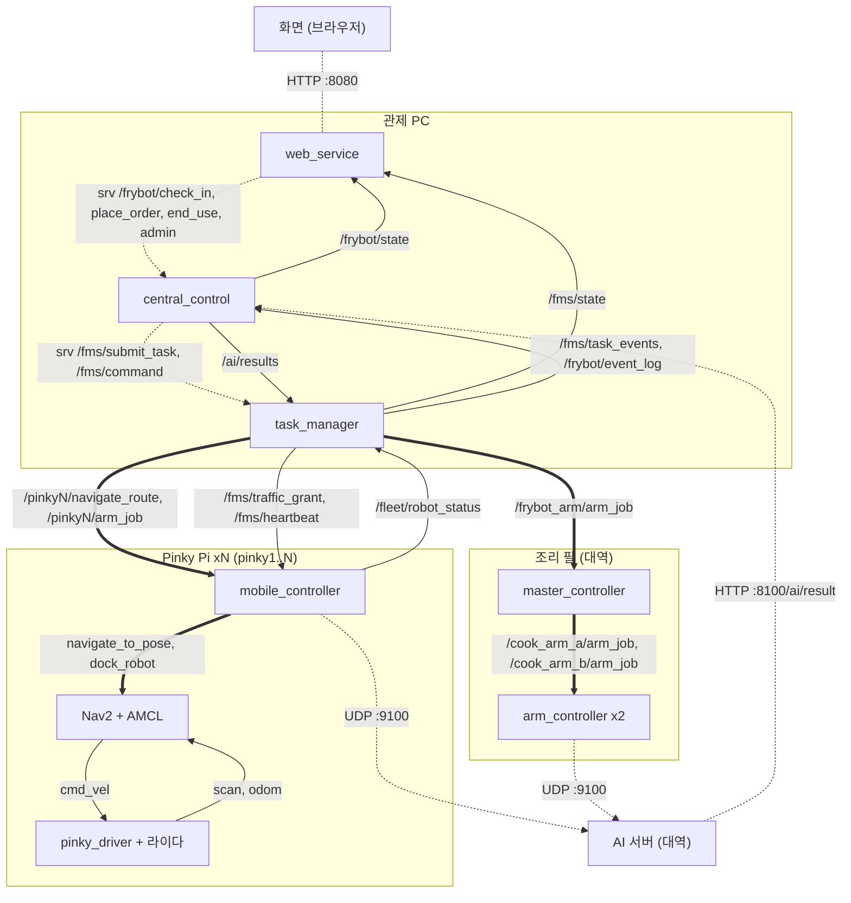

# FryBot — 다중 로봇 협업 스마트 레스토랑

AMR(Pinky) 여러 대가 손님 안내·서빙·식기 회수를 나눠 맡고, 조리 팔 2대가 음식을 만드는 매장을 관제하는 ROS 2 Jazzy 작업 공간입니다. 같은 관제 코드로 경량 시뮬레이션, Gazebo Harmonic + Nav2, 실제 Pinky를 모두 돌립니다.

## 폴더

경로는 작업 공간(`~/frybot_ws`) 기준입니다.

```
src/frybot/frybot_interfaces/    msg·srv·action (인터페이스 원본)
src/frybot/frybot_control/       관제 PC: central_control, task_manager(fleet_core), 스케줄러·플래너, 지도(maps/)
src/frybot/frybot_web/           관제 PC: web_service (HTTP ↔ ROS 2), 관리자·접수·테이블 화면
src/frybot/frybot_mobile/        Pinky Pi: mobile_controller, pinky_driver, pinky_battery, Nav2 설정, 아루코 도킹
src/frybot/frybot_arm/           조리 팔: master_controller, arm_controller(대역), camera_streamer
src/frybot/frybot_sim/           시험: AI 서버 대역, 매장·손님, 시나리오, Gazebo 월드
src/frybot/frybot_bringup/       장치별 launch, RViz 설정, 로봇 목록 예시(config/robots.example.yaml), robot_remote
src/frybot/frybot_description/   로봇 모델 (Pinky Pro, JetCobot 280의 URDF·메시)
```

아키텍처 컴포넌트와 패키지의 대응:

| 컴포넌트 | 패키지 | 노드 |
| --- | --- | --- |
| Central Control, DB | `frybot_control` | `central_control` (식당 상태 State Diagram v4, 실행 로그) |
| Task Manager | `frybot_control` | `task_manager` (임무 배정, 경로 계획, 통행 허가, 조리 셀 조율) |
| Web Service | `frybot_web` | `web_service` (상태를 갖지 않음) |
| FrybotMobile Controller, FrybotNavigator, FrybotMobile Arm Controller, Camera Streamer | `frybot_mobile` | `mobile_controller`, Nav2, `pinky_driver`, `pinky_battery`, `aruco_dock_detector` |
| FrybotArm Master Controller, FrybotArm Controller, Camera Streamer | `frybot_arm` | `master_controller`, `arm_controller` ×2 |
| AI Server (대역) | `frybot_sim` | `ai_server` |

- `frybot_mobile`은 시뮬과 실제 Pinky에서 같은 코드를 씁니다.
- 조리 팔은 구동 방식이 정해지지 않아 `arm_controller`가 대역입니다(관절 애니메이션, 가상 튀김기). 단독 실행: `ros2 launch frybot_arm cooking.launch.py`
- `frybot_description`의 출처와 라이선스는 [패키지 README](frybot_description/README.md)에 있습니다.

## 연결



실선은 토픽, 점선은 서비스와 ROS 밖 통신(HTTP, UDP), 굵은 선은 액션.

- 관제(`task_manager`)가 경로와 공유 구간의 통과 순서를 정하고, AMR은 허가(`TrafficGrant`)받은 구간까지만 갑니다.
- 관제의 생존 신호(`/fms/heartbeat`)가 끊기거나 비상 정지가 오면 AMR은 멈춥니다.
- `mobile_controller`는 방향 전환과 양보 후진 때 Nav2를 거치지 않고 `cmd_vel`을 직접 냅니다. 손님 안내 구간은 Nav2로 후진합니다.
- 손님 안내 중 동행 확인은 `/frybot/guest_track`으로 받습니다. 실기기 런치는 값이 오지 않으면 안내 구간을 출발하지 않습니다(`guest_track_required:=true`가 기본). 시뮬은 값이 한 번도 오지 않으면 확인 없이 안내합니다.
- 같은 목적지로 가는 계획이 20초 넘게 이어서 실패하면 관제는 그 임무를 보류(`SUSPENDED`, 사유 `PLAN_FAIL`)하고 관리자 알람을 냅니다. `RETRY_TASK`로 재개합니다. 다른 로봇이 같은 목적지나 바로 옆 노드로 가는 중이면 이동 명령은 거절됩니다(2026-11-18, T-32·T-33).
- 로봇의 상태 보고가 2초 넘게 끊기면 관제는 새 통행 허가를 내지 않고, 오류를 보고 중인 로봇에는 새 임무를 배정하지 않습니다. 로봇은 위치 추정(TF)이 1초 넘게 갱신되지 않으면 서서 `SENSOR_ERROR`를 보고하고, `pinky_driver`는 `cmd_vel`이 0.5초 넘게 끊기면 모터를 세웁니다.
- 관리자 명령(`/frybot/admin`): `PAUSE`(일시 중단)·`RESUME`, `ESTOP`, `RETRY_TASK`·`REASSIGN`·`CANCEL_TASK`, `GO_HOME`, `MOVE_TO_VERTEX`, `SET_SCHEDULER`·`SET_PLANNER`, `SET_STANDBY`(`on`·`off`), `SET_TABLE`(`AVAILABLE`·`CLOSED`), `END_USE`.

## 인터페이스

원본은 `frybot_interfaces/`의 `msg/`, `srv/`, `action/`입니다. `{pinky}`는 `pinky1..N`, `{arm}`은 `cook_arm_a`, `cook_arm_b`.

### 토픽

| 이름 | 타입 | QoS | 방향 |
| --- | --- | --- | --- |
| `/fms/traffic_grant` | `TrafficGrant` | EVENT | task_manager → AMR (0.5초마다 재발행) |
| `/fms/heartbeat` | `FleetHeartbeat` | DEFAULT 10 | task_manager → AMR (5 Hz, 비상 정지 목록 포함) |
| `/fms/task_events` | `TaskEvent` | EVENT | task_manager → central_control |
| `/frybot/event_log` | `std_msgs/String` | EVENT | task_manager → central_control (실행 로그용) |
| `/fms/state` | `std_msgs/String` (JSON) | DEFAULT 10 | task_manager → web_service |
| `/frybot/state` | `std_msgs/String` (JSON) | DEFAULT 10 | central_control → web_service |
| `/ai/results` | `std_msgs/String` (JSON) | DEFAULT 50 | central_control → task_manager |
| `/fleet/robot_status` | `RobotStatus` | DEFAULT 50 | AMR → task_manager (10 Hz) |
| `/fleet/arm_status` | `ArmStatus` | DEFAULT 20 | 조리 팔 A·B, AMR 서빙 팔 → task_manager (2 Hz, 상태·오류 보고) |
| `/frybot/guest_track` | `GuestTrack` | DEFAULT 10 | central_control → AMR (안내 중인 손님의 동행 상태, AI 서버 결과) |
| `/{pinky}/cmd_vel` | `geometry_msgs/Twist` | DEFAULT 10 | Nav2·mobile_controller → pinky_driver |
| `/{pinky}/odom` | `nav_msgs/Odometry` | DEFAULT 10 | pinky_driver → Nav2 |
| `/{pinky}/scan` | `sensor_msgs/LaserScan` | SENSOR | 라이다 → Nav2, mobile_controller |
| `/{pinky}/battery/percent` | `std_msgs/Float32` | DEFAULT 10 | pinky_battery → mobile_controller |
| `/{pinky}/speed_limit` | `nav2_msgs/SpeedLimit` | DEFAULT 10 | mobile_controller → Nav2 (손님 안내 속도 제한) |
| `/{pinky}/controller_selector` | `std_msgs/String` | LATCHED | mobile_controller → Nav2 (구간에 쓸 제어기: `FollowPath` / `FollowPathReverse`) |
| `/{pinky}/dock_target`, `/{pinky}/detected_dock_pose` | `std_msgs/Int32`, `geometry_msgs/PoseStamped` | DEFAULT 5 | mobile_controller ↔ aruco_dock_detector |

시뮬에서만 쓰는 토픽: `/sim/world_state`(매장·손님 → web_service, AMR), `/sim/customer_cmd`(손님 시뮬레이터 → 매장), `/map`과 `/frybot/markers_static`(LATCHED), `/frybot/markers`(매장 → RViz), `/gz/model_poses`(Gazebo → AMR).

### 액션

| 이름 | 타입 | 방향 |
| --- | --- | --- |
| `/{pinky}/navigate_route` | `NavigateRoute` (mode = NORMAL / GUIDE / YIELD) | task_manager → AMR |
| `/{pinky}/arm_job` | `ArmJob` | task_manager → AMR (서빙 팔) |
| `/frybot_arm/arm_job` | `ArmJob` | task_manager → master_controller |
| `/{arm}/arm_job` | `ArmJob` | master_controller → arm_controller (`arm_id`로 나눔) |
| `/{pinky}/navigate_to_pose` | `nav2_msgs/NavigateToPose` | Pinky 안 (mobile_controller → Nav2) |
| `/{pinky}/dock_robot` | `nav2_msgs/DockRobot` | Pinky 안 (mobile_controller → Nav2 docking_server) |

### 서비스

| 이름 | 타입 | 방향 |
| --- | --- | --- |
| `/frybot/check_in` | `CheckIn` | web_service → central_control |
| `/frybot/place_order` | `PlaceOrder` | web_service → central_control |
| `/frybot/end_use` | `EndUse` | web_service → central_control |
| `/frybot/admin` | `AdminCommand` | web_service → central_control |
| `/fms/submit_task` | `SubmitTask` | central_control → task_manager |
| `/fms/command` | `FleetCommand` | central_control → task_manager |

### QoS

| 이름 | 신뢰성 | 지속성 | 깊이 |
| --- | --- | --- | --- |
| EVENT (코드의 `QOS`) | reliable | volatile | 100 |
| DEFAULT n | reliable | volatile | n |
| SENSOR (`qos_profile_sensor_data`) | best_effort | volatile | 5 |
| LATCHED | reliable | transient_local | 1 |

### ROS 밖

| 구간 | 방식 | 내용 |
| --- | --- | --- |
| 브라우저 ↔ web_service | HTTP :8080 | `GET /api/state, /api/layout, /api/maps, /api/map, /api/events`(`prefix`, `skip`, `since`, `until`, `result`, `limit`), `POST /api/checkin, /api/order, /api/end_use, /api/admin` |
| Camera Streamer → AI 서버 | UDP :9100 | 영상 대신 작은 JSON 프레임 (대역) |
| AI 서버 → central_control | HTTP :8100 | `POST /ai/result` (`kind`: `SEAT_QR`, `DONENESS`, `GUEST_TRACK`) |
| 손님 시뮬레이터 | HTTP :8090 | 가상 매장 시험용 UI |

영상은 ROS로 보내지 않습니다.

## 빠른 시작

```bash
cd ~/frybot_ws && colcon build --symlink-install --packages-up-to frybot_bringup && source install/setup.bash
ros2 launch frybot_bringup sim.launch.py            # 경량 시뮬 + RViz (가상 매장 도면)
ros2 run frybot_sim scenario --scenario demo        # 다른 터미널: 자동 시나리오 (demo | normal | rush | single)
./scripts/stop_all.sh                               # 전체 종료 (단독 명령으로 실행)
```

`colcon build`만 실행하면 외부 저장소(`mycobot_ros2`)에서 실패하므로 `--packages-up-to frybot_bringup`을 붙입니다.

| 화면 | 주소 |
| --- | --- |
| 관리자 (통합 관제 · 테이블/주문 · 알람/이력 · 설정) | http://localhost:8080/admin |
| 입구 접수 키오스크 / 테이블 주문 | http://localhost:8080/reception , http://localhost:8080/table?id=1 |
| 손님 시뮬레이터 (아키텍처 밖 시험용 UI, 가상 매장에서만) | http://localhost:8090 |

상황별 명령은 [docs/COMMANDS.md](../../docs/COMMANDS.md)에 모아 두었습니다.

## 실행 방식

| 방식 | 명령 | 로봇 주행 | 쓰는 곳 |
| --- | --- | --- | --- |
| 경량 시뮬, 가상 매장 | `ros2 launch frybot_bringup sim.launch.py` | 자세를 직접 움직임 | 접수부터 서빙·회수까지 전체 흐름 |
| 경량 시뮬, 실측 지도 | `ros2 launch frybot_bringup sim.launch.py map_id:=test_map_v001` | 자세를 직접 움직임 | 실측 지도의 노드 간 이동, 양보 확인 |
| Gazebo + Nav2 | `ros2 launch frybot_bringup gazebo.launch.py` | 로봇마다 Nav2, costmap 주행 | 주행 검증 (가상 매장 전용) |
| 실기기 | `ros2 launch frybot_bringup real.launch.py map_id:=test_map_v001` | 실제 Pinky의 Nav2 + AMCL | 실측 지도의 노드 간 이동 |
| 오프라인 비교 | `ros2 run frybot_control fleet_bench --scenario rush` | ROS 없이 계산만 | 알고리즘 조합 비교 |

- 경량 시뮬은 Nav2·라이다·AMCL을 거치지 않아 소요 시간이 실기기와 다릅니다(T-23).
- 실측 지도로 띄우면 가상 매장용 노드(매장·손님, 손님 시뮬레이터, 조리 팔, AI 서버)는 뜨지 않습니다.
- 시뮬은 기본으로 전용 도메인 74에서 돌아(`net:=sim`) 켜져 있는 Pinky(도메인 73)와 서로 보이지 않습니다. 시뮬에 `ros2` 명령을 쓰는 터미널에서는 `export ROS_DOMAIN_ID=74`를 먼저 실행합니다. 같은 PC에서 시뮬과 실기기를 함께 띄우지 않습니다.

### 런치 인자

| 인자 | 기본값 | 내용 |
| --- | --- | --- |
| `map_id` | `proto` (시뮬) | 지도 이름. `maps/`의 폴더 이름. 시뮬은 비워 두면 환경 변수 `FRYBOT_MAP_ID`, 그것도 없으면 `proto`. 실기기는 필수 |
| `robots` | `3` (시뮬) | AMR 대수. 이름은 `pinky1..N`. 실기기는 `robots:=2` 또는 `robots:=pinky1,pinky3` |
| `scheduler` | `min_cost_eta_rh` | `min_cost`, `min_cost_eta`, `min_cost_eta_rh`, `priority_greedy`, `fifo_nearest` |
| `planner` | `sipp` | `sipp`, `ccbs`, `cooperative_astar`, `independent_astar` |
| `rviz` | `true` | RViz 표시 |
| `net` | `sim` (시뮬) | `sim`: 시뮬 전용 도메인(`sim_domain`, 기본 74). `local`: 탐색을 이 PC로 제한(Gazebo에서는 Nav2가 주행하지 못함, T-29). `lan`: 실기기와 같은 도메인(예전 기본값) |
| `admin_token` | 없음 (실기기) | 관제 PC가 아닌 기기에서 관리자 명령을 보낼 때 쓰는 토큰. 비워 두면 관리자 명령은 관제 PC에서만 받음 |
| `discovery` | `peers` (실기기) | 로봇은 자기 안과 관제 PC만 탐색하고 로봇끼리는 탐색하지 않음. `subnet`은 예전처럼 같은 대역 전체를 탐색(로봇이 늘면 기동이 크게 느려짐, T-38). 실기기 확인 필요 |
| `standby` | `true` (시뮬), `false` (실기기) | 임무가 없는 로봇의 대기 위치 사용 |
| `cook_time_scale` | `20` | 조리 시간 축소 (튀김 10분 → 30초) |
| `undercooked_prob` | `0.25` | 덜 익음 판정 확률 (시뮬) |
| `qr_vacant_sec` | `8` | 의자 QR이 보인 뒤 빈자리로 판단하기까지의 시간(초) |
| `drive` | `nav2` (Gazebo), `kinematic` (경량 시뮬) | `kinematic`은 자세를 직접 움직임. `cmd_vel`은 costmap 없는 예전 직선 주행 (비교용) |
| `speed`, `guide_speed` | `0.08`, `0.05` | 일반 주행 속도와 손님 안내 속도(m/s) |
| `sim_domain` | `74` (시뮬) | `net:=sim`일 때 쓰는 `ROS_DOMAIN_ID` |
| `run_id` | 없음 | 실행 로그 폴더 이름(`runs/<run_id>`). 비워 두면 `run_YYYYMMDD_HHMMSS` |
| `scenario_name` | `interactive` (경량 시뮬) | 실행 기록(`manifest.json`)에 남기는 시나리오 이름 |
| `sim_time` | `false` (경량 시뮬) | 노드의 `use_sim_time`. Gazebo 런치가 Nav2 주행일 때 `true`로 넘김 |
| `prefer_yield` | `true` (실기기) | 동선이 겹치면 기다리거나 비켜 섬. `false`는 예전처럼 서로 돌아서 감 |
| `gui` | `true` (Gazebo) | Gazebo 창 표시 |
| `remote`, `poses`, `auto_home` | `true`, 없음, `true` (실기기) | SSH 원격 기동, 출발 위치, 출발 노드로 자동 이동. [실기기](#실기기-pinky) 참고 |
| `robots_file` | 없음 (실기기) | 로봇 등록부 경로. 비워 두면 `~/.config/frybot/robots.yaml` |
| `web_port`, `ai_http_port` | `8080`, `8100` (실기기) | `web_service`와 AI 결과 수신 포트 |
| `plan_overhead` | `0.0` | 계획의 구간 지연(초). 구간 시간 = 지연 + 거리 ÷ (`speed` × 0.9). 실기기 권장값은 `plan_overhead:=2.27 speed:=0.135`(실기기 확인 필요). 경량 시뮬은 0.0 |

가상 매장에서 AMR은 최대 7대입니다. 조리 팔 2대는 고정입니다. 4번째 로봇부터는 충전대가 없어 비켜 서는 곳을 홈으로 쓰고, 배터리가 낮으면 빈 충전대를 빌립니다. 자리를 늘리려면 `frybot_control/layout.py`의 `HOME_SPOTS`에 추가합니다. 실측 지도에서는 `roadmap.json`의 `homes` 수가 상한입니다.

## 지도

지도는 `frybot_control/frybot_control/maps/<map_id>/`에 폴더 하나씩 있습니다.

| `map_id` | 내용 |
| --- | --- |
| `proto` | 가상 매장 도면(200×100 cm). `layout.py`에서 만든 파일이며, 치수나 로드맵을 바꾸면 `ros2 run frybot_control export_map --proto`로 다시 만듦 |
| `test_map_v001` | 실측 지도 1번 |
| `test_map_v002` | 실측 지도 2번. v001과 같은 지도 이미지에 로드맵을 줄인 것 (편집 중) |

폴더에는 파일 세 개를 둡니다.

| 파일 | 내용 |
| --- | --- |
| `<map_id>.yaml` | Nav2 지도 설정(`image`, `resolution`, `origin`, 임계값) |
| `<map_id>.pgm` (또는 `.png`) | 점유 격자 이미지 |
| `roadmap.json` | `label`, `map_yaml`, `nodes`(지도 좌표계의 미터 단위 `[x, y]`), `edges`(양방향 통로), `homes`(로봇 번호 순서의 출발 노드), `waiting`(대기 위치), `docking_candidates` |

새 실측 지도를 추가하는 순서:

1. `maps/<새 이름>/`에 위 세 파일을 넣습니다. `roadmap.json`이 있는 폴더는 자동으로 지도 목록에 올라갑니다.
2. 관리자 화면에 노드 역할을 표시하려면 `frybot_web/static/stations-<새 이름>.json`을 만듭니다.
3. `colcon build --symlink-install --packages-select frybot_control frybot_web`으로 다시 빌드합니다.
4. 실기기에 쓰려면 `ros2 run frybot_bringup robot_remote --all --deploy`로 로봇에도 배포합니다. PC와 Pinky가 같은 `map_id`를 써야 합니다.

로드맵을 그릴 때 지킬 것:

- **통행 규칙:** 로봇(11×12 cm)이 노드 간격보다 커서, 중심 거리 15.5 cm(`SAFE_DIST`) 미만인 두 노드는 동시에 점유할 수 없습니다. 예약과 실행 락에 모두 적용됩니다.
- 홈과 대기 위치는 통로 노드와 15.5 cm 이상 떼어야, 서 있는 로봇이 통로를 막지 않습니다.
- 노드는 벽에서 로봇 반길이(6.2 cm) + inflation(7 cm) 이상 띄우는 편이 안전합니다.

실측 지도는 노드 간 이동만 지원합니다. 접수·서빙을 쓰려면 실제 테이블과 작업 지점의 위치가 필요합니다. 관리자 화면의 지도 목록에서는 다른 실측 지도를 미리 볼 수 있고, 실제 주행 지도는 런치의 `map_id`로 정합니다.

## 실기기 (Pinky)

```bash
# 관제 + ~/.config/frybot/robots.yaml 에 등록된 Pinky 전부(SSH)
ros2 launch frybot_bringup real.launch.py map_id:=test_map_v001
# 로봇과 출발 위치 지정 (노드 이름, 선택으로 :방향(도))
ros2 launch frybot_bringup real.launch.py map_id:=test_map_v001 robots:=pinky1,pinky3 poses:=pinky1:A2,pinky3:W3
# 로봇 코드 배포 / 점검 / 정지
ros2 run frybot_bringup robot_remote --all --deploy
ros2 run frybot_bringup robot_remote --all --check
ros2 run frybot_bringup robot_remote --all --stop
```

- 로봇 주소와 계정은 `~/.config/frybot/robots.yaml`에 등록합니다. 비밀번호가 들어가므로 저장소 밖에 두며, `frybot_bringup/config/robots.example.yaml`을 복사해 채웁니다(권한 600). 등록부가 없으면 `robot_remote`는 안내 후 끝나고 `real.launch.py`는 관제만 띄웁니다.
- `map_id`는 필수이고 실측 지도여야 합니다. 빠뜨리거나 `proto`를 주면 런치가 오류로 멈춥니다. 로봇 쪽 `robot.launch.py`도 `map_id:=`가 필수입니다(2026-11-18).
- 시뮬 전용 입력·출력(Gazebo 참값 자세, 가짜 배터리·바퀴 관절값, `/sim/world_state`)은 `frybot_mobile/sim_backend.py`가 맡고 시뮬에서만 붙습니다(2026-11-18, T-36).
- 노드 기본값은 실기기 값입니다(2026-11-18, T-34). 지도를 쓰는 노드는 `FRYBOT_MAP_ID` 없이 띄우면 멈추고, `web_service`는 런치 없이 띄워도 관리자 명령을 관제 PC에서만 받습니다. 시뮬 런치는 시뮬 값을 명시합니다.
- `remote:=false`는 SSH 기동 없이 관제만 띄웁니다. 이때는 각 Pinky에서 `ros2 launch frybot_mobile robot.launch.py robot_id:=pinky1 map_id:=test_map_v001`을 실행합니다.
- 원격 기동은 로봇의 DDS 탐색을 로봇 안과 관제 PC로 제한하고(`discovery:=peers`가 기본), 실측 지도에서는 도킹 노드(`docking_server`, `aruco_dock_detector`)를 띄우지 않습니다(2026-11-18, T-38, 실기기 확인 필요).
- 위치가 잡힌 로봇은 자기 출발 노드(`homes`)로 한 번 스스로 이동합니다(`auto_home:=false`로 끔, 실기기 확인 필요).
- 초기 자세는 `poses:=`로 주거나, RViz의 **2D Pose Estimate**로 지정합니다. 로봇 런치에는 `initial_pose:="x y yaw"`(미터, 라디안)를 넘길 수 있습니다.
- `real.launch.py`는 모든 로봇의 전역·지역 코스트맵이 켜진 RViz를 함께 띄웁니다. `rviz:=false`로 띄웠다면 `ros2 launch frybot_bringup fleet_rviz.launch.py`로 따로 볼 수 있습니다.
- 관리자 화면의 운영 지도에서 로봇과 목적 노드를 고르고 **이동 명령**을 누르면, 관제가 경로와 통행 허가를 보내고 Pinky가 Nav2로 구간을 주행합니다.

준비 절차와 단계별 검증은 [docs/REAL_ROBOT_GUIDE.md](../../docs/REAL_ROBOT_GUIDE.md), 양보·노드 복귀·비상 정지 채널은 [docs/CHANGES_2026-11-16.md](../../docs/CHANGES_2026-11-16.md)에 있습니다.

## 결과 확인

```bash
ros2 run frybot_control analyze_run runs/<run_id>       # 지표 요약 (runs/<run_id>/events.csv)
ros2 run frybot_control replay_run runs/<run_id> -v     # 실기기 로그의 이동 명령을 모의 로봇으로 다시 실행해 비교
ros2 run frybot_control replay_run --find-yield --map-id test_map_v001   # 양보가 일어나는 명령 조합 찾기
```

## 알고리즘

기본값은 `min_cost_eta_rh` + `sipp`입니다. 통로가 로봇 한 대만 지나는 폭(32 cm에 11 cm 로봇, 로봇 간 최소 중심 거리 15.5 cm)이라 단선 로드맵 위에서 시간까지 계획해야 마주침이 없고, 로봇 3대에 임무 몇 건이면 최소 비용 배정이 즉시 풀리기 때문입니다.

| 종류 | 이름 | 내용 |
| --- | --- | --- |
| 경로 | `sipp` | 우선순위 SIPP (Phillips & Likhachev 2011). 먼저 계획한 로봇의 예약을 피해 한 대씩 계획 |
| 경로 | `ccbs` | 충돌 기반 탐색 + SIPP 하위 탐색 (CCBS 계열, Andreychuk et al. 2022). 움직이는 로봇을 함께 계획하고, 충돌하면 어느 쪽이 양보할지 양쪽 다 탐색. 탐색 한도(노드 120개, 0.25초)를 넘으면 우선순위 SIPP로 대체 |
| 경로 | `cooperative_astar` | 0.5초 시간 격자 협조 A* (Silver 2005) |
| 경로 | `independent_astar` | 기준선: 각자 최단 경로 + 실행 중 점유 대기 |
| 배정 | `min_cost` | 최소 비용 배정. 비용 = 그래프 최단 거리 기준 이동 시간 |
| 배정 | `min_cost_eta` | 같은 배정, 비용 = 통로 예약 대기를 포함한 플래너의 도착 예상 시각 |
| 배정 | `min_cost_eta_rh` | ETA 배정 + 롤링 호라이즌: 첫 지점에 닿지 않은 임무를 2초마다 재평가해 5초 넘게 줄면 재배정. 손님 안내 중이거나 음식을 실은 임무는 유지 |
| 배정 | `priority_greedy`, `fifo_nearest` | 기준선 |

`min_cost*`는 2026-11-13 전까지 `hungarian*`이라고 불렀습니다. 배정 문제를 풀 뿐 헝가리안 방법을 구현한 것은 아니어서 이름을 바꿨습니다. 로봇 3대 규모에서는 가능한 배정이 수백 가지뿐이라 전수 탐색으로 최적해를 구하고, 후보가 2만 가지를 넘으면 SciPy `linear_sum_assignment`로 전환합니다. 옛 이름도 런치 인자와 `fleet_bench`에서 그대로 받습니다.

### 교체와 추가

- 스케줄러: `frybot_control/schedulers/__init__.py`의 `Scheduler.assign(tasks, robots, cost, now)`
- 경로 계획: `frybot_control/planners/base.py`의 `PathPlanner.plan(graph, request, reservation_table)`
- 새 알고리즘은 클래스를 만들고 `SCHEDULERS` / `PLANNERS`에 등록하면 런치 인자, 관리자 화면, 벤치마크에 바로 나타납니다.
- 실행 중 교체: 관리자 화면의 선택 상자, 또는 `/frybot/admin` 서비스(`SET_SCHEDULER`, `SET_PLANNER`).

### 비교

```bash
ros2 run frybot_control fleet_bench --scenario bottleneck --seeds 3 --schedulers min_cost min_cost_eta_rh --planners sipp ccbs --csv out.csv
```

- 시나리오는 `normal | rush | bottleneck`, `--seeds N`은 손님 도착 시각을 ±4초 흔든 N회 평균, `--robots N`은 로봇 대수입니다.
- 열: 접수→착석(`seat_avg`), 주문→전달(`deliver_avg`), 조리 완료→전달(`ready_to_deliver`), 점유 대기(`blocked_wait`), 재계획, 계획 시간, 최소 로봇 간격(`min_sep`), 재배정 수.
<!-- [수정 2026-11-18] W3: 시간 모델·흔들림·기준선·통과 판정·실측 지도 이동 명령 -->
- 모의 로봇은 `frybot_control/mock_fleet.py`에 있으며 `replay_run`도 같은 것을 씁니다. 관제 코어는 실기기와 같은 코드입니다.
- `--time-model measured`(구간마다 2.27초 + 거리 ÷ 0.135 m/s, 11-16 실기기 로그에서 맞춘 값), `--overhead`, `--exec-speed`, `--jitter 0.2`(구간 시간 0.8~1.2배), `--plan-speed`(관제의 일반 속도, 런치의 `speed:=`와 같음. 계획은 이 값 × 0.9), `--plan-guide-speed`(관제의 안내 속도, 기본 0.05), `--plan-speed-factor`(계획 속도 배율, 기본 0.9), `--plan-overhead`(관제의 계획 구간 지연)로 실행 조건을 바꿉니다(2026-11-18 W10: `--plan-speed`가 안내 속도까지 바꾸던 것을 고침). 결과의 `eta_ratio`는 계획 ETA 대비 실제 소요 비율의 중앙값입니다.
- `--baseline "fifo_nearest independent_astar"`는 같은 씨앗끼리 짝지어 기준선과의 차이를 냅니다. `--check`는 전부 완료, 계획에 없는 정지가 30초 넘게 이어진 경우 0건, 의도된 대기(계획상 출발 전·비켜 선 뒤 대기·팔 작업)가 20초 넘게 이어진 경우 0건(2026-11-18 추가, 종류별 `intended20_plan`·`intended20_yield`·`intended20_arm`, 참고로 `unplanned20`·`intended30`·`intended_wait_max`), 같은 목적지의 계획 실패가 20초 넘게 이어진 경우 0건, 최소 간격 0.155 m 이상을 판정하고, 못 넘으면 종료 코드 1을 돌려줍니다.
- 실측 지도: `--scenario moves --map-id test_map_v001 --robots 2`는 씨앗으로 정한 이동 명령을 로봇이 한가해질 때마다 넣습니다. 배정 차이는 나오지 않고 경로 계획만 비교됩니다.
- `--csv`는 씨앗당 한 줄, `--csv-mean`은 조합별 평균(예전 `--csv` 형식)입니다. `--jobs N`으로 병렬 실행합니다. `--only-seed N`은 씨앗 하나만 다시 돌리고, `--no-standby`는 임무가 없는 로봇을 항상 충전대로 돌려보내며, `--max-t`는 모의 시간 상한(초, 기본 1500, `measured`는 3000), `--verbose`는 상세 출력입니다. 2026-11-18 비교 결과는 `archive/mock_compare_2026-11/`와 `docs/IMPROVEMENT_PLAN_2026-11-18.md` 9장에 있습니다.

Open-RMF 비교용 플래너 `rmf`, `rmf_nego`와 스케줄러 `rmf_task`는 도우미를 빌드한 경우에만 목록에 나타납니다.

```bash
source /opt/ros/jazzy/setup.bash && cmake -S src/frybot/frybot_control/rmf_bridge -B build/rmf_bridge && cmake --build build/rmf_bridge
```

조합 선정 보고서와 비교 자료(`ALGORITHM_SELECTION_REPORT.md`, `ALGORITHM_BENCHMARK.md`, `bench_*.csv`, `gz_validation/`)는 작업 공간의 `archive/algorithm_comparison_2026-11.tar.gz`에 보관했습니다. 2026-11-14 맵 변경 이전의 수치입니다.

## Gazebo + Nav2 구조

- AMR 노드는 허가받은 구간마다 Nav2 `NavigateToPose`를 보냅니다.
- 로봇마다 다음을 네임스페이스로 띄웁니다. 설정은 `frybot_mobile/config/nav2_store.yaml`, 행동 트리는 `frybot_mobile/config/segment_bt.xml`.
  - `planner_server`: NavFn, 전역 costmap = 매장 맵 + inflation
  - `controller_server`: Regulated Pure Pursuit, 지역 costmap = 라이다 + inflation, 충돌 예측 시 정지
  - `bt_navigator`: 구간용 BT (제어기 선택 → 경로 계산 → 추종, 회복 동작 없음)
  - 제어기는 `FollowPath`와 후진 전용 `FollowPathReverse` 두 개이며, AMR 노드가 구간마다 `/{pinky}/controller_selector`로 고릅니다. 실측 지도에서는 `FollowPath`가 전진 전용이라 손님 안내 구간만 `FollowPathReverse`로 후진합니다.
- 시뮬레이션의 위치 추정은 AMCL 대신 Gazebo의 실제 모델 자세로 map→odom을 보정합니다(`pose_source:=gz`). 바퀴 오도메트리만 쓰면 미끄러짐으로 1 m 넘게 어긋났습니다. 실제 로봇은 `pose_source:=tf`로 AMCL 위치를 씁니다.
- Gazebo 라이다가 주행 중 간헐적으로 무효값만 내보내, 지역 costmap을 1초마다 비우고 최신 스캔으로 다시 채웁니다.
- 손님 안내는 후진 주행입니다. 로봇이 손님을 바라보며 0.05 m/s로 후진하고, Nav2에서는 `speed_limit` 토픽으로 제한합니다.
- 통로가 로봇 한 대 폭이라 제자리 U턴 대신 후진합니다. 양보(`RETREAT`)할 때는 비켜 설 자리를 골라 `mode=YIELD`로 후진해 들어가고, 재계획된 경로가 왔던 길로 되돌아가면 처음 1~2구간을 후진합니다. 자리를 고르는 순서는 두 가지입니다.
  - 길이 막혀 물러날 때: 다른 로봇의 경로에 걸리지 않는 자리, 로봇 뒤쪽에 있는 자리, 가까운 자리 순입니다. 비켜 서는 곳·대기 위치는 두 노드만큼 가깝게 칩니다.
  - 관제가 미리 양보를 정했을 때: 상대의 경로를 실제로 비우고 자기 목적지에도 갈 수 있는 자리만 후보로 삼고, 가까운 자리, 로봇 뒤쪽에 있는 자리 순입니다. 비켜 서는 곳·대기 위치는 한 노드만큼 가깝게 칩니다.
- 방향 전환은 AMR 노드가 Nav2에 목표를 보내기 전에 직접 합니다(제자리 회전 중 costmap 충돌 판정으로 멈추는 문제 방지). 가상 매장에서는 Nav2가 같은 구간을 3번 실패하거나 15초 동안 2 cm도 나아가지 못하면 그 구간만 직접 주행하고, 실측 지도에서는 재시도 뒤 `NAV2_FAILED`를 돌려줍니다.

## 가정한 것 (팀 확인 필요)

가상 매장 도면(`proto`)에 해당하는 내용입니다.

- **테이블 번호와 정지 지점:** 2026-11-13 맵 치수표 기준이며 번호는 조리 구역 쪽부터 셉니다(1 오른쪽 위, 2 오른쪽 아래, 3 가운데 오른쪽, 4 가운데 왼쪽, 5 왼쪽 위, 6 왼쪽 아래). 테이블의 x 위치와 정지 지점은 치수표에 없어 도면에서 읽었습니다. AMR은 안내·서빙·회수 모두 테이블 앞의 같은 지점에 서고(`layout.py`의 `TABLES`, `guide`와 `serve`가 같은 값), 지점은 좌석 구역에서 11 cm(`STOP_GAP`) 떨어져 있습니다.
  - 가운데 4인석(3·4번)은 위·아래 통로 쪽에 한 곳씩 있고, Task Manager가 로봇에게 더 빠른 쪽을 고릅니다. 3번: (131,33)·(131,67), 4번: (74,33)·(74,67)
  - 벽 쪽 2인석: 1번 (131,23), 2번 (131,77), 5번 (54,23), 6번 (54,77)
  - 위·아래 통로(y = 28, 72)는 x = 38, 101, 153의 세로 통로로 이어집니다.
- **비켜 서는 곳과 대기 위치:** 비켜 서는 곳(5·6번과 1·2번 사이)과 대기 위치(1·2번 오른쪽)는 경로 그림 기준으로 넣었고 치수는 추정입니다. 임무가 없는 AMR 한 대는 충전대(입구 쪽)에, 나머지는 대기 위치(조리 구역 쪽)에 섭니다. 배터리 40% 미만이면 충전대로 갑니다.
- **퇴식구:** 맵 치수표에 없어 조리 구역 가운데(183, 50)로 두었습니다.
- **음식 받는 곳:** 후라이드 → 튀김 받는 곳, 양념치킨·볶음밥 → 볶음밥 받는 곳(웍 팔 B가 올림).
- **서빙 팔:** AMR에 붙는 서빙 팔은 실제 크기로는 실을 수 없어 RViz에서 0.3배로 표시합니다.
- **DB:** MySQL 대신 실행 폴더의 SQLite 파일입니다(테이블 이름은 논리 모델과 같음).
- **AI 서버:** 추론은 임계값 모의입니다(익힘: 황금색 비율 0.9 이상, 의자 QR: 보이는 개수).
- **조리:** 조리 시간은 `cook_time_scale`로 줄였고, 조리 팔 동작은 관절 애니메이션입니다(집기·물리 없음).
