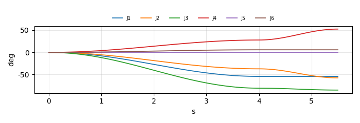
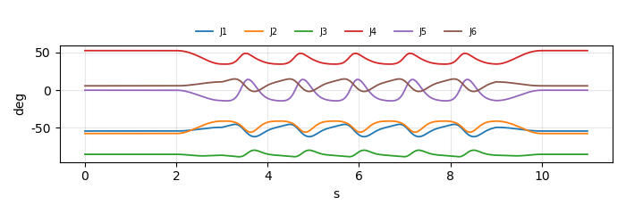
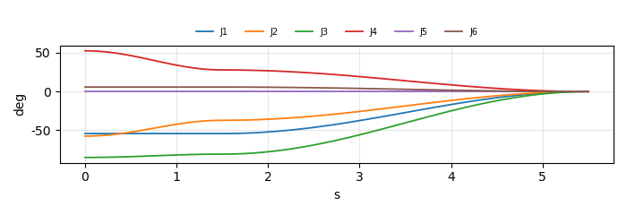

# 젯코봇 동작 공유

동작 파일 하나 = `motions/` 안의 JSON 하나. 형식은 ROS2 `trajectory_msgs/JointTrajectory` 구조
(`joint_names`, `points[].positions` 라디안, `points[].time_from_start`) + 이름·로봇·상태 같은 정보.

**가장 쉬운 방법: `동작플레이어.sh` (처음 한 번 우클릭 → 프로그램으로 실행, 다음부터 바탕화면 아이콘)**
→ 브라우저에 목록·그래프, 버튼으로 RViz 재생 / 실제 로봇 재생 / 정지 / 손으로 따기.
실제 로봇은 이 PC 에서 SSH 로 움직임 (로봇에 설치할 것 없음). 팀 공용 키 `jetcobot-team.key` 를 다운로드 폴더에 두면 자동 인식.

| 하고 싶은 것 | 코드로 하는 방법 |
|---|---|
| 실제 로봇 재생 · 손으로 따기 | `웍질_재생.ipynb` (주피터) |
| RViz 에서 보기 | 노트북의 RViz 셀, 또는 `source /opt/ros/jazzy/setup.bash && python3 tools/play_rviz.py motions/<파일>.json` |
| 동작 올리기 | 노트북 `record()`/`save()` → `motions/` 에 저장 → GitHub 에 올리기 |

이 페이지는 `tools/make_index.py` 가 자동으로 만든다. 직접 고치지 말 것. 도구 설명은 README.md.

## 동작 목록

| # | 상태 | 이름 | 로봇 | 길이 | 만든 방법 | 만든 사람 |
|---|---|---|---|---|---|---|
| 1 | 확정 | [1 로봇2 웍 들고 화구로 (기본자세→화구)](#1) | 로봇2 (jetcobot_aab4) | 5.5초 | 테스트 도구 (MoveIt 경로) | 관리자 (테스트 도구) |
| 2 | 확정 | [2 로봇2 크랭크 웍질 (1.2초×5)](#2) | 로봇2 (jetcobot_aab4) | 11.0초 | 크랭크 공식 (sources/make_toss_크랭크스냅_1.2초_20261127.py) | 관리자 (테스트 도구) |
| 3 | 확정 | [3 로봇2 웍 들고 복귀 (화구→기본자세)](#3) | 로봇2 (jetcobot_aab4) | 5.5초 | 테스트 도구 (MoveIt 경로) | 관리자 (테스트 도구) |

## 동작별 자세히

### 1. 1 로봇2 웍 들고 화구로 (기본자세→화구)

- 파일: [`motions/1_로봇2_웍_들고_화구로_기본자세→화구.json`](motions/1_로봇2_웍_들고_화구로_기본자세→화구.json)
- 상태: **확정** · 로봇: 로봇2 (jetcobot_aab4) · 길이 5.5초 (111점)
- 만든 방법: 테스트 도구 (MoveIt 경로)
- 재생 권장: 속도 80, 앞당김 0.12초, 30Hz
- 메모: 세로 꽂기 공구 필요. 크랭크 웍질 시작 자세에서 끝남

### 2. 2 로봇2 크랭크 웍질 (1.2초×5)

- 파일: [`motions/2_로봇2_크랭크_웍질_1.2초x5.json`](motions/2_로봇2_크랭크_웍질_1.2초x5.json)
- 상태: **확정** · 로봇: 로봇2 (jetcobot_aab4) · 길이 11.0초 (221점)
- 만든 방법: 크랭크 공식 (sources/make_toss_크랭크스냅_1.2초_20261127.py)
- 재생 권장: 속도 80, 앞당김 0.12초, 30Hz
- 메모: 2026-11-27 OK. 실물 속도 50~100 성공. 처음엔 0.5배

### 3. 3 로봇2 웍 들고 복귀 (화구→기본자세)

- 파일: [`motions/3_로봇2_웍_들고_복귀_화구→기본자세.json`](motions/3_로봇2_웍_들고_복귀_화구→기본자세.json)
- 상태: **확정** · 로봇: 로봇2 (jetcobot_aab4) · 길이 5.5초 (111점)
- 만든 방법: 테스트 도구 (MoveIt 경로)
- 재생 권장: 속도 80, 앞당김 0.12초, 30Hz

